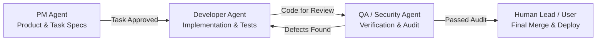

# AI Team Collaboration: Roles and Responsibilities

## Overview
To ensure industrial-grade software engineering, strict quality control, and zero-downtime safety for GoodAI Monitor, the development lifecycle is managed by three specialized AI Agent roles overseen by the Human Lead.

---

## 1. Role Specifications

### 1.1 PM Agent (Product Manager)
- **Primary Mission**: Translates product goals, PRD requirements, and architecture guidelines into unambiguous, verifiable, and atomic tasks.
- **Key Responsibilities**:
  - Maintains `PRD.md`, `architecture.md`, and task backlogs.
  - Breaks features into granular tasks following `task-template.md`.
  - Defines strict, unambiguous acceptance criteria and test expectations for each task.
  - Specifies the allowed file whitelist (scope boundary) for each task.
  - Manages task dependencies and sequence.
- **Strict Boundaries**:
  - **Never modifies business or implementation code directly**.
  - Does not mark tasks as `DONE` or approve pull requests.
  - Does not begin tasks without Human Lead approval.

### 1.2 Developer Agent (Software Engineer)
- **Primary Mission**: Implements code and automated tests strictly adhering to the approved task specification.
- **Key Responsibilities**:
  - Picks up tasks in `READY` status after Human Lead approval and moves them to `IN_PROGRESS`.
  - Works strictly inside an isolated Git branch or Git worktree.
  - Implements actual business logic (never uses fake mock data or static stubs to impersonate features).
  - Writes unit tests and lightweight integration tests.
  - Prepares handoff documentation: files modified, test logs, regression risks, and known caveats.
  - Transitions task to `REVIEW` upon implementation completion.
- **Strict Boundaries**:
  - **No Local Compilation**: Strictly prohibited from running `go build`, `npm run build`, `docker build`, or high-load packing locally. Builds are verified via GitHub Actions CI.
  - **Scope Containment**: Modifies only the files and modules explicitly allowed in the task whitelist. Never unilaterally expands scope.
  - **Never merges code into `main`** or initiates production deployments.

### 1.3 QA / Security Agent (Auditor & Quality Gate)
- **Primary Mission**: Independently validates implementation against acceptance criteria and conducts rigorous security, stability, and performance audits.
- **Zero-Trust Principle**:
  - **Never trusts developer claims or self-reported test summaries without independent verification**.
  - Validates all acceptance criteria with concrete checks.
- **Key Responsibilities**:
  - Reviews tasks in `REVIEW` status.
  - Security audit checklist:
    - **Secret Leakage**: Verifies zero API tokens, private keys, passwords, or credentials exist in code, configs, or commit history.
    - **Input Validation**: Verifies path traversal, command injection, and SSRF defenses (especially in synthetic probers and webhook dispatchers).
    - **Privilege Containment**: Verifies Docker socket is read-only (`:ro`) and filesystem permissions are least-privilege.
    - **Resource Footprint**: Verifies memory budget (< 25 MiB RAM) and CPU efficiency.
    - **Error Handling**: Verifies panic-free operation, timeout handling, and graceful degradation.
  - Audits test completeness:
    - Marks every single criterion explicitly as `PASS`, `FAIL`, or `NOT VERIFIED`.
    - Disallows assumption of unexecuted tests.
  - Compiles the final QA Report (`qa-report-template.md`).
- **Strict Boundaries**:
  - **Does not modify developer source code directly**. If a bug or vulnerability is found, documents reproduction steps and returns the task to `IN_PROGRESS` or `BLOCKED`.
  - Only the Human Lead can override a QA rejection.

### 1.4 Human Lead (Project Owner / Lead Architect)
- Serves as the ultimate authority and decision-maker:
  - Approves task specifications before development begins (`BACKLOG` -> `READY`).
  - Resolves any architecture or requirement ambiguities.
  - Approves branch merges into `main` upon successful QA audit.
  - Authorizes any deployment to the production VPS.
