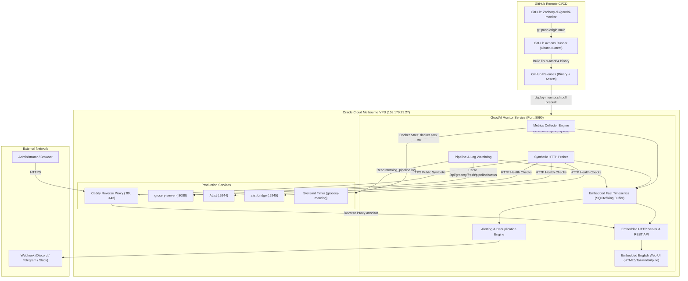

# Architecture & Technical Design: GoodAI Monitor

## 1. System Objectives & Design Principles

### 1.1 Objectives
GoodAI Monitor is a specialized, production-grade monitoring and observability system engineered for GoodAI infrastructure and digital services. It provides 24/7 visibility into:
1. **Host Infrastructure**: Real-time CPU, RAM, Swap, Disk, and Load metrics.
2. **Container Ecosystem**: Status, uptime, restart counts, and health of Docker containers (`caddy`, `grocery-server`, `alist`, `alist-bridge`).
3. **Application & Business Health**: Status of the NZ Grocery price engine, API health, and the daily 07:50 NZDT Morning Pipeline execution.
4. **Synthetic Probing**: External and internal latency, HTTP status codes, and TLS certificate lifecycle.
5. **Real-time Alerting**: Immediate webhook notifications on service failures, memory pressure, or pipeline aborts with anti-flapping deduplication.
6. **Unified Status Dashboard**: A responsive, 100% English Web UI featuring high-density real-time metrics and incident history.

### 1.2 Non-Negotiable Constraints
- **Strict No-Build Rule**: Zero compilation, bundling, or image building on the VPS or local dev machine. All builds must occur in GitHub Actions CI/CD.
- **Ultra-Low Resource Footprint**: 
  - Host RAM is ~1GB with active services consuming ~550MB.
  - The monitor service must operate with **RAM usage < 30 MiB** and **CPU idle usage < 0.5%**.
- **No Chinese Text**: All user-facing UI, code comments, system logs, and error messages must be strictly in English. Project management and milestone reporting to the user remain in Chinese.
- **Zero Disruption**: Must not disrupt existing reverse proxy configs, ports, or running Docker containers.

---

## 2. System Architecture Diagram

---

## 3. Technology Stack Selection & Rationale

| Layer | Selected Technology | Rationale | Alternatives Considered & Rejected |
|---|---|---|---|
| **Language & Runtime** | **Go (Golang 1.24+)** | Produces a single static binary (`CGO_ENABLED=0`). Memory consumption is typically 12–20 MiB RSS. Goroutines provide cheap non-blocking periodic probe intervals. Fast startup (<50ms). | **Node.js**: Requires 60–100MB RAM runtime. **Python**: High RAM usage, dependency overhead. **Rust**: Heavy local compile times. |
| **Storage Engine** | **Pure Go SQLite (`modernc.org/sqlite`) + In-Memory Ring Buffer** | Zero CGO dependency. Zero server process overhead. Keeps recent 1-hour high-resolution samples in memory and persists hourly summaries & incidents to SQLite with automatic 14-day rolling retention pruning. | **PostgreSQL/MySQL**: Unacceptable RAM overhead for a 1GB VPS. **Prometheus/InfluxDB**: Overkill, high memory footprint. |
| **Containerization** | **Scratch or Alpine:3.20 Docker Image** | Total image size < 25 MB. Read-only root filesystem with read-only Docker socket mount (`/var/run/docker.sock:ro`). | Heavy base images. |
| **Frontend UI** | **Vanilla HTML5 + Modern CSS / Tailwind + Alpine.js (Embedded via Go `embed.FS`)** | 100% English UI. Zero npm build on the server. Bundled directly into the Go executable, allowing immediate serving without external static asset dependencies. | React/Next.js/Vue SPA requiring heavy node builds and SSR overhead. |
| **Reverse Proxy Integration** | **Caddy Reverse Proxy (`monitor.goodai.co.nz` or subpath)** | Extends existing Caddy architecture with automatic TLS certificates via Let's Encrypt / ZeroSSL. | Nginx (not currently in use on the host). |
| **CI/CD** | **GitHub Actions** | Remote runner executes `go test`, static analysis, and cross-compiles `goodai-monitor-linux-amd64`. Uploads precompiled artifacts to GitHub Releases. | Local building (violates strict constraint). |

---

## 4. Key Functional Modules

### 4.1 Host Metrics Collector
- **Metrics Collected**:
  - CPU: Usage percentage, user/system breakdown, load averages (1m, 5m, 15m).
  - Memory: Total, used, available, cached, swap total, swap used.
  - Disk: Root filesystem usage (`/`), used bytes, total bytes, inode usage.
  - Network: Network interface RX/TX bytes and error rates.
  - Host Uptime and process count.
- **Collection Frequency**: Configurable (default: every 15 seconds).

### 4.2 Docker Container Inspector
- Connects directly to `/var/run/docker.sock` in read-only mode.
- Queries state for target containers: `caddy`, `grocery-server`, `alist`, `alist-bridge`, `goodai-monitor`.
- Tracks:
  - Execution state (`running`, `exited`, `restarting`, `dead`).
  - Uptime duration and container start timestamp.
  - Restart count.
  - Health check status (`healthy`, `unhealthy`, `starting`).
  - Per-container CPU and Memory consumption.

### 4.3 HTTP Synthetic Prober
- Probes configured endpoints periodically:
  - `https://price.goodai.co.nz` (External synthetic check: status 200, TLS certificate validity and days remaining, response latency).
  - `http://127.0.0.1:8088/api/grocery/status` (Grocery server internal health).
  - `http://127.0.0.1:5244/api/public/settings` (AList internal health).
  - `http://127.0.0.1:5245/` (AList bridge).
- Records HTTP response code, DNS time, TLS handshake time, TTFB, and total latency.

### 4.4 Morning Pipeline Business Watchdog
- Specifically tailored for GoodAI NZ Grocery price pipeline:
  - Queries `http://127.0.0.1:8088/api/grocery/fresh/pipeline/status`.
  - Captures:
    - Overall Status: `PASS`, `FAIL`, `RUNNING`, or `UNKNOWN`.
    - Data Counts: `raw_products`, `canonical_products`, `canonical_members`.
    - Phase 2 Audits: `produce_report.status`, `meat_report.status`.
    - Daily run date: `today_date`.
  - Watchdog Rule: If current time exceeds `08:30 NZDT` and today's pipeline is not `PASS`, an alert is triggered.
  - Reads the tail of `/opt/family-hub-vps/grocery_data/morning_pipeline.log` to present the latest execution log in the dashboard.

### 4.5 Alerting & Notification Engine
- **Trigger Conditions**:
  - Container down or unexpected restart.
  - Host RAM usage > 85% or Swap usage > 80%.
  - Host Disk usage > 90%.
  - Morning Pipeline overall status == `FAIL`.
  - Morning Pipeline not completed by `08:30 NZDT`.
  - HTTP probe failure (consecutive failed probes >= 3).
  - TLS certificate expiring within 14 days.
- **Anti-Flapping & Throttling**:
  - Cooldown periods (e.g., minimum 30 minutes between repeated alerts of the same type).
  - Auto-resolution alerts when service recovers.
- **Channels**:
  - Generic Webhook (JSON payload).
  - Discord Webhook.
  - Telegram Bot API.

### 4.6 REST API & Status Web UI
- **Endpoints**:
  - `GET /api/v1/status`: Comprehensive live snapshot of all services, host metrics, and pipeline status.
  - `GET /api/v1/metrics/history`: Historical timeseries data for charts (1h / 24h / 7d).
  - `GET /api/v1/incidents`: Active and resolved incidents.
  - `GET /api/v1/pipeline`: Detailed Morning Pipeline status and historical run logs.
  - `GET /healthz`: Liveness probe for the monitor itself.
- **UI Design**:
  - 100% English terminology.
  - High information density, modern dark/light mode dashboard.
  - Real-time auto-refresh via Server-Sent Events (SSE) or polling.
  - Mobile and desktop responsive.

---

## 5. Security & Isolation Design

1. **Authentication**:
   - Optional HTTP Basic Auth or Bearer Token for the dashboard and API.
   - Public view can be configured to display high-level service status without exposing internal system paths or IPs.
2. **Read-Only Privilege**:
   - Docker socket mounted strictly with `:ro`.
   - Log files mounted strictly with `:ro`.
   - The monitor daemon cannot modify host configurations or restart production containers without explicit operator intervention.
3. **Secrets Management**:
   - All credentials and webhook tokens configured via environment variables.
   - Zero hardcoded tokens or secrets in source code.
