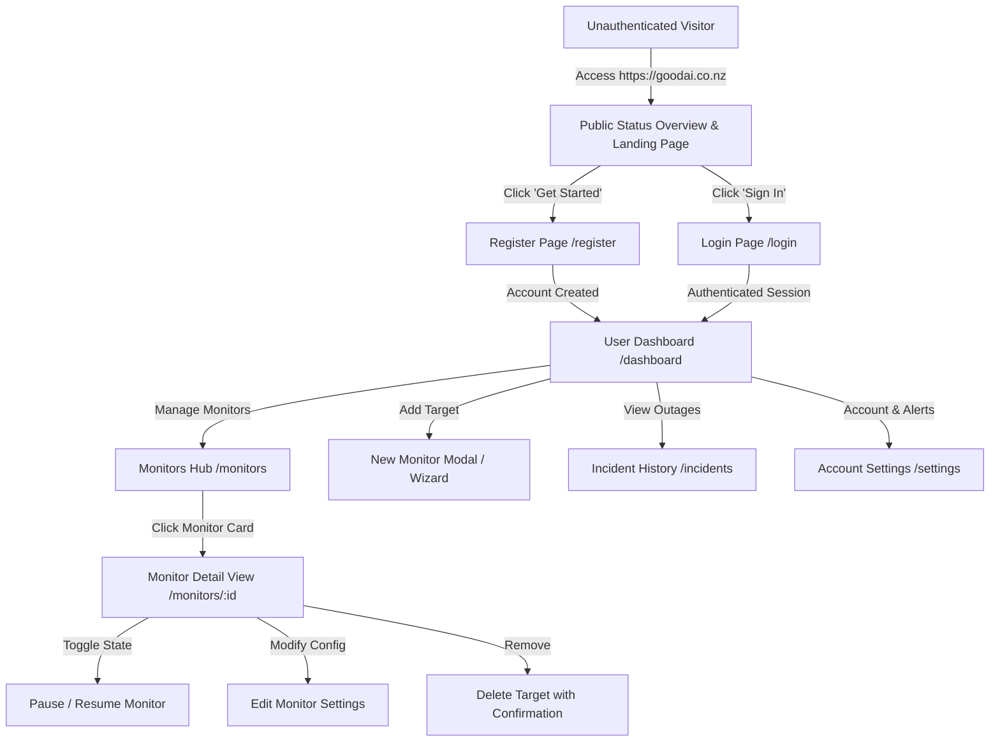
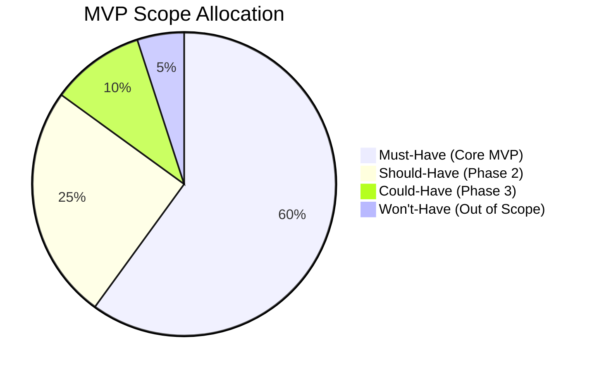
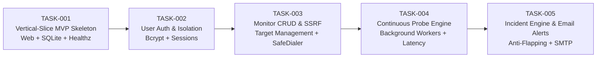

# Product Requirements Document (PRD): GoodAI Monitor

**Document Version**: 1.0.0  
**Product Stage**: MVP (Minimum Viable Product)  
**Author**: PM Agent  
**Reviewer**: Human Lead (Project Owner)  
**Status**: DRAFT (Awaiting Human Lead Review)  
**Source Baseline**: `docs/product-brief.md`, `docs/architecture-review.md`, `docs/initial-audit.md`

---

## 1. Executive Summary & Product Vision

### 1.1 Product Vision
**GoodAI Monitor** is a reliable, lightweight, and modern website availability monitoring and fault diagnosis service. It empowers website owners, small businesses, and independent developers to ensure their online services are consistently accessible, providing instant notifications and clear diagnostics when outages occur.

Unlike static landing pages or simulated demos, GoodAI Monitor is an authentic, production-grade cloud service deployed on `https://goodai.co.nz`:
- Continuous 24/7 background probing independent of active user sessions.
- Multi-tenant user registration, authentication, and strictly isolated workspaces.
- Real-time fault detection with anti-flapping hysteresis and email alerts.
- Transparent historical response times, SLA uptime percentages, and incident logs.
- Engineered for extreme resource efficiency (< 25 MiB RSS) and 100% natural, professional English user experience.

---

## 2. Target Users & Personas

| Persona | Needs & Goals | Core MVP Pain Points Addressed |
|---|---|---|
| **Personal Site Owner / Blogger** | Wants to know immediately if their personal portfolio or blog goes down. | Simple setup, free of complex enterprise configurations, low barrier to entry. |
| **Small Business Operator** | Depends on their commercial website or lead-gen portal for daily sales. | Reliable incident confirmation without false alarms; instant email notifications. |
| **Independent Developer / DevOps** | Manages multiple APIs, webhooks, and production websites. | Clean status dashboard, latency trend charts, HTTP status code and keyword assertions. |
| **Public Visitor** | Wants to check whether GoodAI services are currently operational. | Transparent, clean public status view without logging in. |

---

## 3. Core User Journeys & Information Architecture

### 3.1 User Journey Overview



### 3.2 Page Inventory & Navigation Structure

| Route / Page | Access Control | Primary User Objectives |
|---|---|---|
| **`/` (Public Landing & Status)** | Public (Visitor) | Value proposition, system availability overview, entry points to Sign In / Register. |
| **`/login`** | Public (Guest) | Secure email & password authentication, validation error feedback. |
| **`/register`** | Public (Guest) | User registration (Email, Password, Name), instant onboarding. |
| **`/dashboard`** | Authenticated User | High-level operations cockpit: active monitors count, overall health status, current outages banner, 24h average latency, quick actions. |
| **`/monitors`** | Authenticated User | Filterable list of all user-owned monitors (status badges, uptime %, current response time, search). |
| **`/monitors/new`** | Authenticated User | Create monitor form (URL, friendly name, check interval, timeout, expected HTTP code, keyword). |
| **`/monitors/:id`** | Authenticated (Owner only) | Deep-dive telemetry: latency history graph, recent 50 check logs, uptime %, incident log. |
| **`/incidents`** | Authenticated User | Consolidated incident history log across all owned monitors (active vs resolved, duration, root cause). |
| **`/settings`** | Authenticated User | Account profile, notification email configuration, alert preferences, password change. |

---

## 4. MVP Functional Requirements

### 4.1 Authentication & Data Isolation (FR-AUTH)
- **FR-AUTH-01 (Registration)**: Users can sign up with Email, Password (min 8 chars), and Display Name.
- **FR-AUTH-02 (Password Security)**: Passwords must be hashed using `bcrypt` (cost $\ge 10$). Plaintext passwords must never be stored, logged, or serialized.
- **FR-AUTH-03 (Session Management)**: Authenticated sessions use cryptographically random session tokens stored in secure, `HttpOnly`, `SameSite=Lax` cookies.
- **FR-AUTH-04 (Multi-Tenant Isolation)**: Strict row-level isolation. Every database query for monitors, checks, and incidents **must** enforce `WHERE user_id = ?`. User A cannot view, modify, or delete User B's data under any condition.

### 4.2 Monitor Target Management (FR-MON)
- **FR-MON-01 (Creation)**: Users can create monitoring targets with:
  - Friendly Name (e.g., "Company Website", "Checkout API").
  - Target URL (`http://` or `https://`).
  - Check Interval (Options: 1 min, 5 min, 10 min; default: 1 min).
  - Timeout (Options: 3s, 5s, 10s; default: 5s).
  - Expected HTTP Status Code (default: 200, or custom comma-separated list like `200,204,301`).
  - Optional Keyword Assertion (case-insensitive substring check in response body, max 100 chars).
- **FR-MON-02 (URL Validation & SSRF Guard)**: System validates URL format and immediately rejects invalid protocols, malformed hostnames, and forbidden network destinations (see NFR-SEC).
- **FR-MON-03 (Edit & Pause)**: Users can edit monitor configurations or toggle `Paused` state. When paused, background probing stops immediately and uptime calculation freezes.
- **FR-MON-04 (Deletion)**: Users can delete a monitor with explicit confirmation. Cascading deletion clears associated check logs and incident records.

### 4.3 Background Probing Engine (FR-PROBE)
- **FR-PROBE-01 (Autonomous Continuous Probing)**: Background worker pool schedules and executes HTTP/HTTPS checks according to configured intervals without requiring user browser sessions.
- **FR-PROBE-02 (Check Telemetry)**: Each check measures and records:
  - Overall status (`UP`, `DOWN`, `DEGRADED`).
  - HTTP response status code.
  - Total response latency (milliseconds).
  - Detailed timing breakdown (DNS lookup, TCP connect, TLS handshake, TTFB).
  - Human-readable error reason on failure (e.g., `Connection refused`, `TLS certificate expired`, `Timeout after 5000ms`, `Expected keyword 'Success' not found`).
- **FR-PROBE-03 (TLS Certificate Inspection)**: For HTTPS targets, checks capture certificate validity and days remaining until expiration.
- **FR-PROBE-04 (Content Truncation)**: Response bodies are capped at 64 KB during keyword scanning to prevent memory bloat.

### 4.4 Incident Management & Anti-Flapping (FR-INC)
- **FR-INC-01 (Consecutive Failure Confirmation)**: A monitor transitions from `UP` to `DOWN` **only after $N$ (default: 2) consecutive check failures**. A single transient timeout does not trigger an incident or send alerts.
- **FR-INC-02 (Incident Creation)**: Upon confirmation of downtime, an incident record is generated:
  - Unique Incident ID.
  - Linked Monitor ID and User ID.
  - Started timestamp (`started_at`).
  - Root cause description and status code.
  - Status set to `OPEN`.
- **FR-INC-03 (Automatic Recovery)**: A monitor transitions from `DOWN` back to `UP` **only after $M$ (default: 2) consecutive successful checks**. The incident record is updated:
  - Resolved timestamp (`resolved_at`).
  - Total duration computed (e.g., "14 minutes 30 seconds").
  - Status set to `RESOLVED`.
- **FR-INC-04 (Incident History)**: Complete timeline of past outages preserved and accessible in the monitor details view and incident hub.

### 4.5 Email Alert Dispatcher (FR-ALERT)
- **FR-ALERT-01 (Down Alert)**: Sends an email immediately when an incident status transitions to `OPEN`:
  - Subject: `[Incident Alert] <Monitor Name> is DOWN`
  - Body: Monitor name, target URL, failure time (NZDT & UTC), error details, and direct link to incident dashboard.
- **FR-ALERT-02 (Recovery Alert)**: Sends an email immediately when an incident transitions to `RESOLVED`:
  - Subject: `[Resolved] <Monitor Name> is back UP`
  - Body: Total downtime duration, recovery timestamp, and resolution confirmation.
- **FR-ALERT-03 (Anti-Spam & Rate Limiting)**: Maximum 1 alert email per incident. No repeated emails sent during an ongoing outage.

### 4.6 Dashboard & Data Visualization (FR-UI)
- **FR-UI-01 (100% English Language)**: Entire user-facing interface strictly rendered in natural, modern English (zero Chinese characters in code, UI, or templates).
- **FR-UI-02 (Status Badges)**: Clear visual badges:
  - `UP` (Green)
  - `DOWN` (Red)
  - `DEGRADED` (Yellow)
  - `PAUSED` (Gray)
  - `PENDING` (Blue - newly created, awaiting initial probe)
- **FR-UI-03 (Uptime Percentage Formula)**: Displays 24-hour, 7-day, and 30-day uptime calculated strictly as:
  $$\text{Uptime \%} = \frac{\text{Successful Probes}}{\text{Total Scheduled Probes (excluding paused)}} \times 100$$
- **FR-UI-04 (Real-time Telemetry Graph)**: Clean SVG or lightweight Canvas latency trend chart showing the last 24 hours of response times.

---

## 5. Non-Functional Requirements & Security

### 5.1 Resource & Performance Budget (NFR-PERF)
- **NFR-PERF-01 (Host RAM Budget)**: Daemon process RSS must remain strictly under **25 MiB** under normal multi-user operation.
- **NFR-PERF-02 (CPU Efficiency)**: Average CPU utilization during background polling must stay under **1.0%** on the 2-vCPU host.
- **NFR-PERF-03 (API Response Latency)**: REST API endpoints must return within **50ms** ($p95 < 100\text{ms}$).

### 5.2 Server-Side Request Forgery (SSRF) Protection (NFR-SEC)
Because users can submit arbitrary URLs, SSRF is the highest security vulnerability.
- **NFR-SEC-01 (Disallowed IP Ranges)**: The probe engine dialer (`SafeDialContext`) resolves target hostnames and **strictly drops TCP connections** to:
  - IPv4 Loopback (`127.0.0.0/8`)
  - RFC 1918 Private Ranges (`10.0.0.0/8`, `172.16.0.0/12`, `192.168.0.0/16`)
  - Cloud Metadata / Link-Local (`169.254.0.0/16`, specifically Oracle Cloud IMDS `169.254.169.254`)
  - IPv6 Loopback (`::1`), Link-Local (`fe80::/10`), and IPv4-Mapped IPv6 (`::ffff:0:0/96`)
- **NFR-SEC-02 (DNS Rebinding TOCTOU Defense)**: IP verification occurs inside the custom socket dialer at TCP connection time (`net.Dialer.Control` / `DialContext`), dialing the exact verified IP directly.
- **NFR-SEC-03 (Redirect Blocking)**: The HTTP probe client sets `CheckRedirect = http.ErrUseLastResponse`, preventing attackers from redirecting from a public domain to internal resources.
- **NFR-SEC-04 (Port Whitelist)**: Prober only allows standard web ports: `80`, `443`, `8080`, `8443`. Requests to internal service ports (`60324`, `5244`, `5245`, `8088`, `2019`) are rejected.

### 5.3 Reliability & Process Durability (NFR-REL)
- **NFR-REL-01 (Zero-Loss Restart)**: All monitor definitions and check histories are persisted in SQLite WAL mode. On daemon restart, scheduled probes resume seamlessly.
- **NFR-REL-02 (Graceful Shutdown)**: Handles `SIGINT`/`SIGTERM` with a 10s drain window, finishing active probe goroutines and flushing WAL cache.

---

## 6. Recommended Quotas, Retention & Pending Decisions

### 6.1 Recommended Quotas & Thresholds
| Parameter | Recommended Value | Rationale | Status |
|---|---|---|---|
| **Max Monitors per User** | 10 monitors | Prevents resource exhaustion on 1GB RAM VPS while being generous for personal/small business use. | `RECOMMENDED` |
| **Minimum Check Interval** | 60 seconds (1 minute) | Probing faster than 60s risks CPU contention and rate-limiting from target sites. | `RECOMMENDED` |
| **Check Timeout** | 5 seconds (max 10s) | Prevents hanging goroutines and socket leaks. | `RECOMMENDED` |
| **Raw Check Log Retention** | 14 days | Individual probe logs pruned after 14 days to keep SQLite file size < 50 MB. | `RECOMMENDED` |
| **Incident History Retention** | 90 days | Lightweight summary rows kept longer for quarterly reliability reviews. | `RECOMMENDED` |
| **Consecutive Failure Threshold ($N$)** | 2 consecutive checks | Eliminates 95% of false alerts caused by transient internet routing blips. | `RECOMMENDED` |
| **Consecutive Recovery Threshold ($M$)** | 2 consecutive checks | Prevents flapping notifications during unstable target reboots. | `RECOMMENDED` |

### 6.2 Pending Decisions for Human Lead

```markdown
### Decision Item 1: Root Domain Routing & Existing Services
- **Context**: User confirmed pointing `@` (goodai.co.nz) A record to VPS (158.179.29.27).
- **Options**:
  - Option A (Recommended): Caddy serves GoodAI Monitor at `https://goodai.co.nz` on port 443. Existing `price.goodai.co.nz` is temporarily routed to a maintenance response or disabled in Caddyfile as requested.
  - Option B: Maintain `price.goodai.co.nz` alongside `goodai.co.nz`.
- **Recommendation**: Option A.

### Decision Item 2: Public Status Page vs Landing Overview
- **Context**: User asked "保持公开只读仪表盘？"
- **Options**:
  - Option A (Recommended): Public visitors to `https://goodai.co.nz` see a high-level public status page (displaying GoodAI's own public services and an active platform status overview), with buttons to "Sign In" / "Register" for personal monitoring workspaces.
  - Option B: Public visitors are immediately redirected to `/login`, requiring credentials before viewing any metrics.
- **Recommendation**: Option A. Provides transparent public value while protecting private user monitors.

### Decision Item 3: Email Notification Service Provider
- **Context**: MVP requires real email alerts for outages.
- **Options**:
  - Option A: Standard SMTP integration (e.g., Resend, SendGrid, Amazon SES, or Brevo SMTP credentials via `.env`).
  - Option B: Local sendmail/postfix on VPS (Not recommended due to IP reputation / spam deliverability).
- **Recommendation**: Option A (SMTP relay credentials in `.env`).
```

---

## 7. Requirement Prioritization (MoSCoW Matrix)



### 7.1 Must-Have (MVP Release)
- [x] User registration, login, logout, and password hashing (`bcrypt`).
- [x] Row-level multi-tenant data isolation (`WHERE user_id = ?`).
- [x] Create, view, edit, pause, resume, and delete monitors (max 10 per user).
- [x] Background continuous probing engine (HTTP/HTTPS, status code, latency, keyword).
- [x] Strict SSRF protection (private IP / IMDS / loopback blocking at dial time).
- [x] Incident lifecycle engine ($N=2$ failure confirmation, $M=2$ recovery, deduplication).
- [x] Real SMTP email outage and recovery alerts.
- [x] Responsive 100% English Web dashboard, latency charts, and incident hub.
- [x] SQLite WAL database with 14-day rolling log pruning.
- [x] Native GitHub Actions CI/CD remote build workflow.

### 7.2 Should-Have (Phase 2 Post-MVP)
- Custom user-configured public status pages (`/status/:slug`).
- Discord & Telegram webhook notification integrations.
- Multi-channel notification settings per monitor.
- SSL certificate expiry warning alerts (7 days in advance).

### 7.3 Could-Have (Phase 3 Future)
- Ping / ICMP probes and TCP port monitoring.
- Export check logs to CSV.
- Custom HTTP request headers and authorization tokens.

### 7.4 Won't-Have (Strictly Out of Scope for MVP)
- ❌ **AI Incident Analysis & Root-Cause Generation** (Deferred per product brief).
- ❌ **Paid Billing, Stripe integration, or subscription plans**.
- ❌ **Multi-region distributed probe nodes**.
- ❌ **SMS or voice phone call alerts**.
- ❌ **Multi-user team permissions and RBAC roles**.

---

## 8. Architectural Alignment & Conflict Analysis

| Product Requirement | Existing Architecture (`architecture.md`) | Potential Conflict / Gap | Resolution & Design Decision |
|---|---|---|---|
| **Multi-Tenant User System** | Architecture originally designed for single-operator internal VPS monitor. | High. Existing model lacked `users` table, password hashing, and session authentication. | **Resolved**: Added `users` and `sessions` tables to SQLite schema. Enforced `user_id` foreign key on all `monitors`, `checks`, and `incidents`. |
| **Arbitrary User-Submitted URLs** | Architecture assumed static internal URLs (`127.0.0.1:8088`, `price.goodai.co.nz`). | Critical Security. Allowing arbitrary URLs introduces SSRF to internal ports and cloud IMDS. | **Resolved**: Implemented strict `SafeDialContext` blocking private IPs, loopback, and `169.254.169.254`. Blocked internal port range. |
| **Continuous Background Probing** | Architecture used static cron goroutines for host `/proc` stats. | Medium. Need dynamic concurrent scheduler that adds/removes probes as users CRUD monitors. | **Resolved**: Worker pool design using Go channels and ticker map (`sync.Map`), waking on monitor changes. |
| **Email Alert Notifications** | Architecture only specified webhooks (Discord/Telegram). | Medium. Product Brief mandates real email notifications. | **Resolved**: Integrated standard Go `net/smtp` / TLS mailer with template engine. |
| **Root Domain (`goodai.co.nz`) on Port 443** | Architecture planned for `monitor.goodai.co.nz` or subpath on `price.goodai.co.nz`. | Low. Cloudflare already routes `@` to `158.179.29.27`. | **Resolved**: Updated Caddyfile design to terminate HTTPS for `goodai.co.nz` and reverse proxy to `:8090`. |

---

## 9. First Batch Development Task Breakdown (Phase 1 MVP)

Following `docs/ai-team/task-template.md`, the MVP is decomposed into 5 atomic, testable, vertically-sliced tasks:



### Task Summary Table
1. **`TASK-001`**: **Vertical-Slice Runnable MVP Skeleton** (Go HTTP Server on `:8090`, embedded English UI shell, SQLite WAL engine, `/healthz` endpoint, and GitHub Actions CI workflow).
2. **`TASK-002`**: **User Authentication & Multi-Tenant Data Isolation** (Registration, login, bcrypt password hashing, secure session cookies, user dashboard shell).
3. **`TASK-003`**: **Monitor Target Management & SSRF Validation Engine** (Monitor CRUD API, UI modals, strict `SafeDialer` blocking private IPs and Oracle IMDS).
4. **`TASK-004`**: **Background Continuous Probing Engine & Telemetry** (Concurrent worker pool, DNS/TCP/TLS/HTTP/Keyword probing, latency logging, 14-day retention trimmer).
5. **`TASK-005`**: **Incident State Machine & SMTP Email Alerting** ($N=2$ failure confirmation, $M=2$ recovery, deduplication, SMTP email dispatcher).
