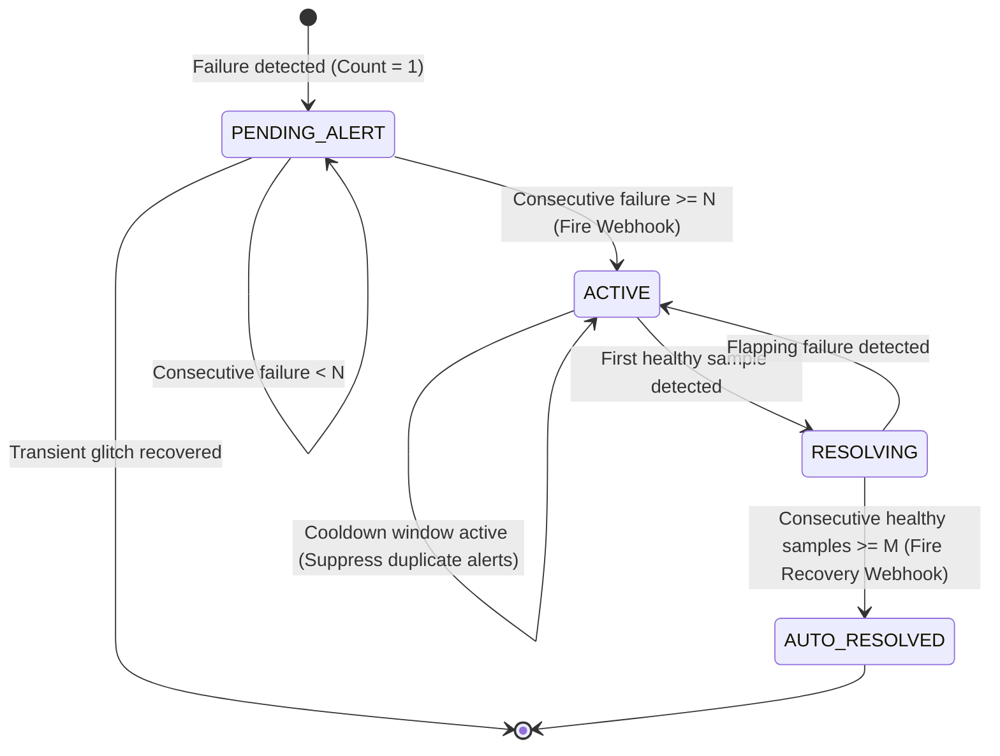
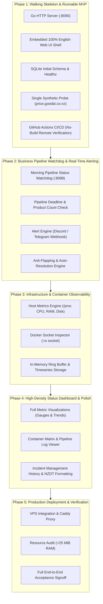

# Product & Architectural Review: GoodAI Monitor

**Document Version**: 1.0.0  
**Author**: PM Agent  
**Review Target**: Architecture, Implementation Plan, Initial Audit, Roles, Decision Log  
**Date**: 2026-10-13  
**Status**: COMPLETE (Handoff to Human Lead)

---

## Executive Summary

This independent review evaluates **GoodAI Monitor** from the perspectives of **Product Management, Requirements Completeness, and Task Sequencing**. 

GoodAI Monitor is designed to observe a resource-constrained production environment (Oracle Cloud Melbourne VPS: 2 vCPU, 954 MiB RAM) hosting critical business services (`caddy`, `grocery-server`, `alist`, `alist-bridge`) and a daily scheduled batch pipeline (`07:50 NZDT Morning Pipeline`).

### Key Findings Summary
1. **Business Completeness**: The current architecture correctly captures core technical endpoints, but lacks business anomaly intelligence (e.g. abrupt product count drops), systemd timer level supervision, and log permission design in containerized environments.
2. **Incident Lifecycle**: The architecture mentions an "Incident table" but omits a formal incident state machine, deduplication key strategy, severity levels, and auto-resolution hysteresis.
3. **Task Sequencing Flaw**: The existing Implementation Plan is organized **horizontally** (Phase 1 = Host `/proc` collector), deferring runnable server, database, and UI verification to Phase 3 and Phase 4. This delays end-to-end verifiable value. A **vertical-slice MVP** strategy is strongly recommended.
4. **Missing Requirement Artifact**: `Gemini.md` stipulates reading `PRD.md`, but no `PRD.md` exists in the repository.

---

## 1. Product Requirements Completeness Review

### 1.1 Coverage of Infrastructure, Services & Morning Pipeline

| Scope Area | Current Architectural Design | Coverage Assessment | Missing Requirements / Product Risks | Status |
|---|---|---|---|---|
| **Host Infrastructure** | Reads `/proc/stat`, `/proc/meminfo`, `/proc/loadavg`, and filesystem stats via pure Go (no CGO). | **Good** | In a Dockerized deployment, reading `/proc` directly may read the container's isolated `/proc` rather than host metrics unless `--pid=host` or host `/proc` is mounted. | `RECOMMENDED` |
| **Container Ecosystem** | Queries `/var/run/docker.sock` (:ro) for `caddy`, `grocery-server`, `alist`, `alist-bridge`. | **Comprehensive** | Covers execution state, uptime, restart counts, and healthchecks. Needs rate limiting on Docker socket polling to prevent CPU spikes on low-spec host. | `VERIFIED` |
| **GoodAI NZ Grocery Price Engine** | Synthetic HTTP checks against `:8088/api/grocery/status` and external `https://price.goodai.co.nz`. | **Good** | Caddy reverse proxy blocks public `/api/grocery/sync*`. Synthetic checks must not trigger rate-limits or bypass intended security barriers. | `VERIFIED` |
| **07:50 NZDT Morning Pipeline** | Polls `/api/grocery/fresh/pipeline/status`, checks `08:30 NZDT` deadline, reads tail of `morning_pipeline.log`. | **Partially Complete** | 1. **No Systemd Unit Probing**: If `grocery-morning.timer` fails to trigger `grocery-morning.service`, the bash script never executes. Probing only the HTTP API will detect delay only at 08:30, not when the timer fails at 07:50. 2. **Data Drop Anomaly Detection**: Capturing product counts (`raw_products`, `canonical_products`) is passive; it lacks threshold rules (e.g., alert if product count drops by >20% vs yesterday due to supermarket anti-scraping blocks). 3. **Immediate Failure Alerting**: Clarify that status == `FAIL` triggers immediate alerting without waiting for the 08:30 deadline. | `RECOMMENDED` |
| **Pipeline Log Access** | Reads `/opt/family-hub-vps/grocery_data/morning_pipeline.log`. | **Design Gap** | When GoodAI Monitor runs in Docker, this host path must be mounted read-only (`:ro`). File rotation and non-existent initial file cases must be gracefully handled without panicking. | `RECOMMENDED` |
| **Caddy TLS & Proxy Health** | Synthetic probe checks HTTPS 200, TLS certificate validity, expiration days remaining (<14 days). | **Comprehensive** | Caddy admin API (`127.0.0.1:2019`) is also active on host; could optionally provide internal proxy telemetry if needed. | `VERIFIED` |
| **Self-Monitoring & Watchdog** | Monitor runs on 954 MiB host under strict <25 MiB budget. | **Design Gap** | If host suffers extreme memory pressure and OOM-killer terminates `goodai-monitor`, who alerts the team? A lightweight external health ping (e.g. Healthchecks.io / cron heartbeat) is needed. | `RECOMMENDED` |

---

### 1.2 Incident Lifecycle & Data Model Analysis

The architecture specifies an "Incident table" in SQLite and webhook alerts, but leaves the incident lifecycle under-specified. An industrial-grade incident engine requires a deterministic state machine:

#### Incident Model Requirements:
1. **Deterministic Deduplication Key (`dedup_key`)**:
   - Format: `<target_type>:<target_name>:<metric_rule>` (e.g., `container:grocery-server:status_not_running`, `synthetic:price_goodai:http_5xx`, `pipeline:morning_fresh:status_failed`, `host:memory:ram_over_85`).
   - Prevents duplicate incident rows from being inserted during ongoing outages.
2. **Severity Hierarchy**:
   - `CRITICAL`: Production container down, Morning Pipeline `FAIL`, HTTP probe consecutive 5xx.
   - `WARNING`: Host RAM > 85%, TLS cert expires in < 14 days, pipeline delayed past 08:15 NZDT.
   - `INFO`: Container restarted but currently healthy, auto-resolution event.
3. **Hysteresis Recovery (Anti-Flapping)**:
   - Alert creation requires $N$ (e.g., 3) consecutive failed probes.
   - Auto-resolution requires $M$ (e.g., 2) consecutive successful probes to prevent alert storms caused by flapping network links.
4. **Presentation Requirements**:
   - `GET /api/v1/incidents`: Supports filtering by `?status=active` and `?status=resolved`.
   - UI Dashboard: Top alert banner for active incidents, collapsible incident history table with dual timestamps: **NZDT (Pacific/Auckland)** and **UTC**.

---

## 2. Critique of Task Sequencing & Roadmapping

### 2.1 The Problem with the Current Plan (Horizontal Slicing)

In `docs/implementation-plan.md`, Phase 1 is specified as:
- **P1-T1**: Go skeleton & config
- **P1-T2**: Host `/proc` collector
- **P1-T3**: Docker socket reader
- **P1-T4**: GitHub Actions CI/CD
- **P1-T5**: Release deploy script

#### Why was this proposed?
This reflects a traditional **bottom-up / backend-infrastructure-first** engineering pattern: build data collectors first, then network probers (Phase 2), then storage and API (Phase 3), then UI (Phase 4), and finally alerts (Phase 5).

#### Product Management Critique:
1. **Deferred Verifiable Value**: At the end of Phase 1, the user and QA Agent have no web interface, no HTTP endpoint, and no database. The output is merely JSON printed to terminal stdout.
2. **Late Discovery of Architectural Risks**:
   - Embedded frontend assets (`embed.FS`) and HTTP routing are delayed to Phase 4.
   - Pure-Go SQLite (`modernc.org/sqlite`) memory behavior under WAL mode is delayed to Phase 3.
   - If SQLite or HTTP serving encounters memory budget issues, this is discovered late in the roadmap rather than day 1.
3. **Core Business Value Inversion**: The most critical business differentiator for GoodAI is the **NZ Grocery Price Engine uptime & 07:50 Morning Pipeline**, NOT generic Linux CPU/RAM metrics. Putting host collectors ahead of business health inverted product priorities.

---

### 2.2 Proposed Product-Oriented "Thin Vertical Slice" Roadmap

To deliver **immediate, end-to-end verifiable value on Day 1**, we propose restructuring the roadmap into thin vertical slices:

### 2.3 Value Comparison: Existing Plan vs Proposed Roadmap

| Metric | Existing Horizontal Plan | Proposed Vertical-Slice Roadmap |
|---|---|---|
| **Runnable UI / Browser Access** | Delivered in **Phase 4** | Delivered in **Phase 1 (Day 1)** |
| **HTTP API & Healthz** | Delivered in **Phase 3** | Delivered in **Phase 1** |
| **Core Business Pipeline Watchdog** | Delivered in Phase 2 | Delivered in **Phase 2 (Immediate next step after MVP)** |
| **Memory Budget De-risking** | Delayed until Phase 3/4 | De-risked immediately (HTTP + SQLite + Embed in Phase 1) |
| **QA Verification Capability** | QA can only inspect unit mocks until Phase 4 | QA can verify end-to-end HTTP responses, UI rendering, and CI artifacts from Task 1 |

---

## 3. Comprehensive Status Categorization

Each review finding is classified into one of four standard statuses:

| Item ID | Topic | Finding / Architectural Decision | Status | Rationale / Recommendation |
|---|---|---|---|---|
| **F-01** | Strict No-Build Policy | Local environment and VPS must not run compilers (`go build`, `npm build`, `docker build`). | `VERIFIED` | Confirmed by `Gemini.md` and `ADR-002`. Local VPS has only 954 MiB RAM. |
| **F-02** | 100% English UI/Logs Policy | Zero Chinese characters in frontend UI, API responses, logs, or comments. Communications to Human Lead remain Chinese. | `VERIFIED` | Confirmed by `Gemini.md` and `ADR-003`. QA will enforce zero Chinese text in code review. |
| **F-03** | Missing `PRD.md` | `Gemini.md` mentions reading `PRD.md`, but no `PRD.md` file exists in the repo root. | `RECOMMENDED` | PM Agent should draft a clean, canonical `PRD.md` reflecting GoodAI Monitor scope and requirements. |
| **F-04** | RAM Budget Limit (< 25–30 MiB) | VPS currently has ~408 MiB free RAM. Daemon must stay under 25 MiB RSS. | `VERIFIED` | Confirmed by `docs/initial-audit.md` and `ADR-001`. Pure Go without heavy frameworks is essential. |
| **F-05** | Incident State Machine & Schema | Need formal incident table schema, deduplication keys, hysteresis, and severity. | `RECOMMENDED` | Define standard schema (`dedup_key`, `severity`, `status`, `triggered_at`, `resolved_at`) in `internal/model`. |
| **F-06** | Systemd Timer Supervision | Pipeline triggered via `grocery-morning.timer`. API prober only alerts if API returns FAIL or is late. | `RECOMMENDED` | Add optional DBUS or systemd unit state check if feasible, or rely on pipeline watchdog with clear deadline alerts. |
| **F-07** | Product Count Anomaly Alert | Pipeline data counts (`raw_products`, `canonical_products`) must alert if dropping >20% day-over-day. | `RECOMMENDED` | Prevent silent scraper failure (e.g. Pak'nSave upstream blocking IP returning 0 products with HTTP 200). |
| **F-08** | Caddy Routing Domain Selection | Whether GoodAI Monitor is exposed as `monitor.goodai.co.nz` (subdomain) or `/monitor` (subpath). | `NEEDS HUMAN DECISION` | Subdomain requires DNS A record pointing to `158.179.29.27`. Subpath requires path rewriting in existing Caddyfile. |
| **F-09** | Basic Auth vs Open Dashboard | Should the monitor dashboard have HTTP Basic Auth enabled by default or open read-only status? | `NEEDS HUMAN DECISION` | Internal VPS metrics may expose container names and internal ports; Basic Auth recommended for public internet. |
| **F-10** | External Heartbeat / Watchdog | If GoodAI Monitor process itself terminates due to OOM, who alerts the admin? | `RECOMMENDED` | Integrate lightweight dead-man's-snitch or external webhook ping. |
| **F-11** | Task Sequencing Restructuring | Pivot Phase 1 from Host Collector to Runnable Web Server + Embedded UI + SQLite MVP. | `RECOMMENDED` | Delivers demonstrable value immediately and de-risks architectural layers early. |

---

## 4. Fact vs Assumption Verification Matrix

| Claim / Component | Type | Basis / Evidence | Risk / Action Required |
|---|---|---|---|
| Melbourne VPS IP `158.179.29.27` has 954 MiB RAM, 2 vCPUs, Ubuntu 24.04 | **VERIFIED FACT** | `docs/initial-audit.md` confirmed via remote audit. | Host OOM is a real physical danger; must enforce No-Build. |
| Services `caddy`, `grocery-server`, `alist`, `alist-bridge` run in host network mode | **VERIFIED FACT** | `docs/initial-audit.md` container inspection. | Monitor port `8090` must not collide with existing ports `80, 443, 8088, 5244, 5245, 60324`. |
| Morning pipeline runs daily at 07:50 NZDT via `/opt/family-hub-vps/scripts/morning_pipeline.sh` | **VERIFIED FACT** | `docs/initial-audit.md` systemd timer inspection. | Monitor must have timezone awareness (`Pacific/Auckland`). |
| Git repository has zero commits on `main` branch | **VERIFIED FACT** | `git status` output confirms clean uncommitted repository state. | Need initial commit with project scaffold. |
| `modernc.org/sqlite` with WAL mode will stay under 15 MiB RAM under load | **ASSUMPTION (NOT VERIFIED)** | In-memory cache size and statement caching need empirical verification in Go CI. | Benchmark RAM usage in CI test suite with 10,000 metrics records. |
| Docker socket `/var/run/docker.sock` will be mounted `:ro` inside monitor container | **ASSUMPTION (PENDING DEPLOY)** | Required by `docs/architecture.md` and QA checklist. | Must be enforced in `docker-compose.yml`. |
| Pipeline log path `/opt/family-hub-vps/grocery_data/morning_pipeline.log` is readable by container | **ASSUMPTION (NOT VERIFIED)** | Path specified in `.env.example`, but permissions on host not tested. | Deployment script must ensure file read permissions (`chmod 644`). |
| Supermarket API changes or IP bans will be caught by existing pipeline endpoints | **ASSUMPTION (NOT VERIFIED)** | Pipeline script does fail if data cannot be fetched, but exact failure response format must be validated. | Unit test parser with mock pipeline responses from real log samples. |

---

## 5. Recommended Action Plan & Next Steps

1. **Human Lead Decisions Required**:
   - **Decision 1**: Choose between subdomain (`monitor.goodai.co.nz`) vs subpath (`price.goodai.co.nz/monitor`).
   - **Decision 2**: Confirm authentication policy for dashboard (default `AUTH_ENABLED=true` with Basic Auth vs open status page).
   - **Decision 3**: Approve proposed **Vertical-Slice Task Sequencing** for Phase 1.
2. **PM Agent Actions**:
   - Generate official `PRD.md` documenting product requirements and constraints.
   - Restructure `docs/implementation-plan.md` to reflect the Vertical-Slice MVP roadmap.
   - Create initial task files in `docs/ai-team/tasks/` in `BACKLOG` state:
     - `TASK-001-runnable-mvp-web-server.md` (Runnable Go web server + embedded English UI + Healthz + CI)
     - `TASK-002-sqlite-incident-store.md` (Storage model + incident deduplication schema)
     - `TASK-003-morning-pipeline-watchdog.md` (07:50 NZDT watchdog + business anomaly detection)
     - `TASK-004-synthetic-probe-alerting.md` (HTTP probers + webhook notifications)
     - `TASK-005-host-docker-collectors.md` (Host `/proc` + Docker socket inspector)
